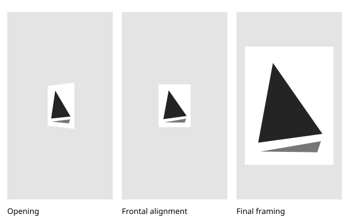

# Cinematic Geometry Demo

A reproducible pinhole-camera study using an original procedural composition on a flat plane. It samples a curved, target-locked approach, followed by a straight push-in once the camera faces the artwork squarely.



## Run

Use Python 3.10 or later. No third-party dependencies are required.

```sh
python geometry.py --output out
python -m unittest -v
```

The command writes an SVG contact sheet and a JSON file with 51 sampled camera positions and verification metrics.

| Geometry check | Expected |
| --- | --- |
| Artwork centre remains at frame centre | Subpixel error across all samples |
| Camera moves along the artwork normal during the push-in | Zero lateral movement |
| Artwork width at the end | 84% of the viewport |
| Final artwork aspect ratio | 3:4 |
| Final artwork corners | All inside the viewport |

The opening projection exhibits perspective foreshortening. At frontal alignment the move changes from angular motion to a change in camera distance. A single focal length is used throughout. The demo uses projected geometry and flat fills. It does not require a 3D renderer, original artwork or room photographs.

[MIT License](LICENSE), copyright Nikita Khilko.
